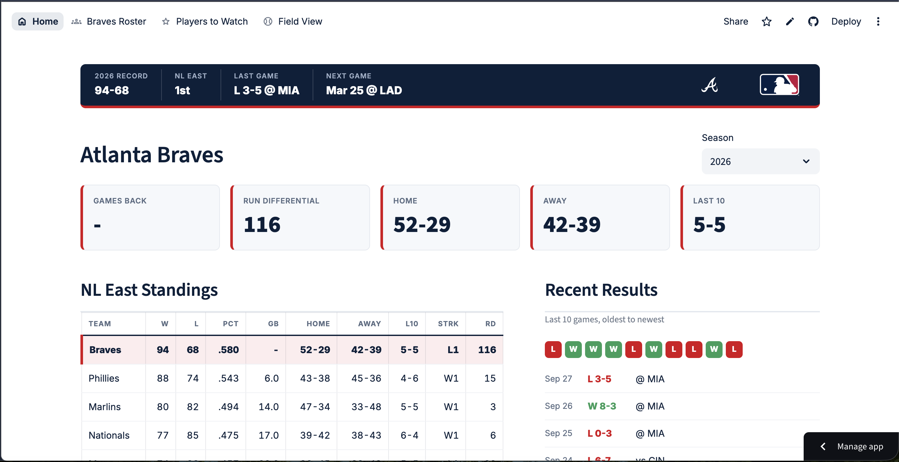
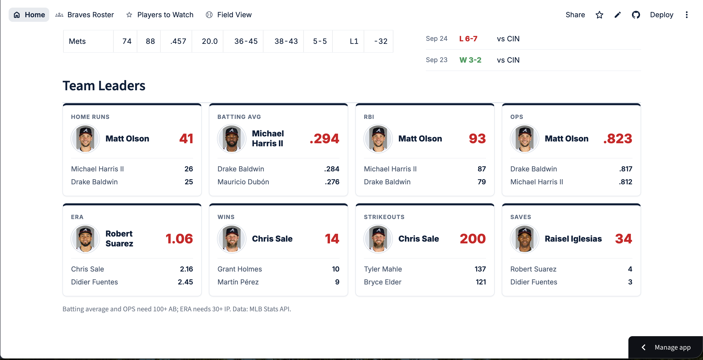
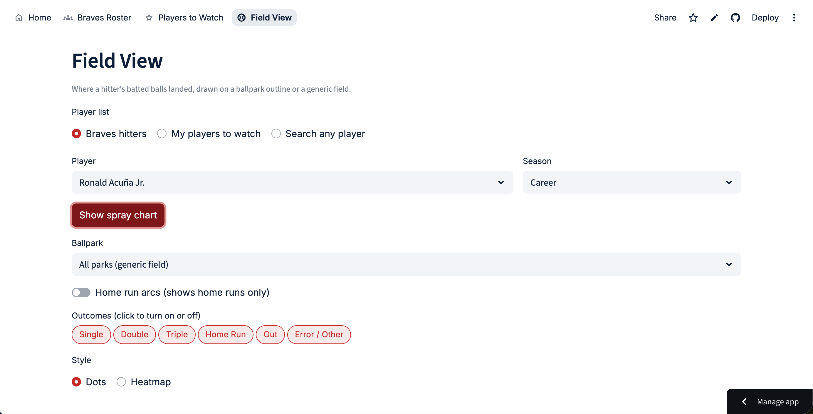
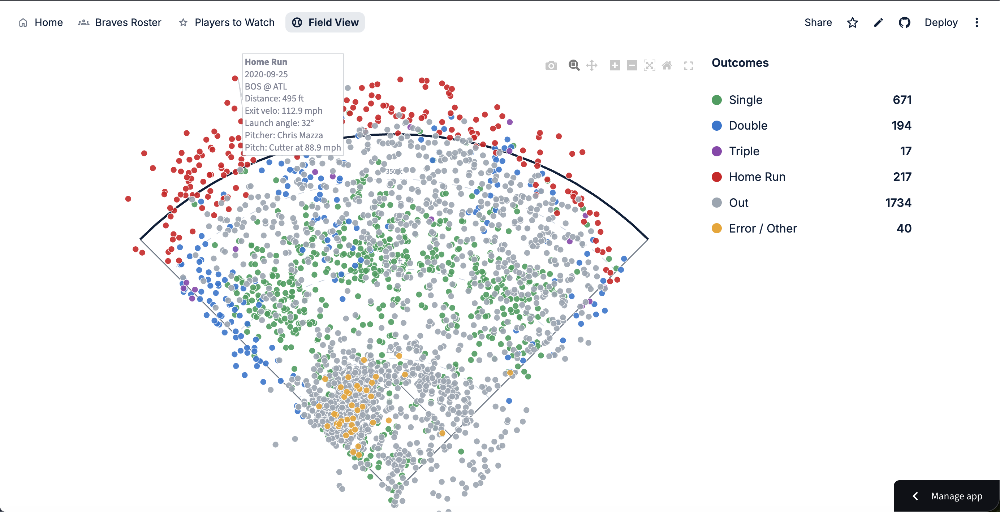

# Baseball Analytics Dashboard

An interactive baseball stats dashboard built with Python and Streamlit. It tracks the Atlanta Braves roster, standings and team leaders, lets you follow players from around the league, and includes a Statcast spray chart explorer with hover details and home run flight arcs.

**Live app:** https://braves-dashboard.streamlit.app/






## Features

- **Home:** NL East standings, last 10 games, recent results, and team leaders in hitting and pitching (with minimum at-bat and innings thresholds so small samples can't top the rate stats).
- **Braves Roster:** sortable hitting and pitching tables for any season, filterable by roster type (40-man, active, full season) and status (active, injured list, minors).
- **Players to Watch:** a curated list of players from around the league with season stats and headshots.
- **Field View:** Statcast batted-ball data for any hitter, shown on a real ballpark outline or a generic field.
  - Season selector limited to the seasons that player actually played, plus a career option
  - Clickable outcome filters with a fixed color for each outcome
  - Hover details: distance, exit velocity, launch angle, pitcher, pitch type and speed
  - Home run arcs colored by distance, with a home run log
  - Heatmap view for career data
- **Header stat strip:** live Braves record, division rank, last game and next game.

## Tech stack

- **Python**, **pandas** and **NumPy** for data cleaning and transformation
- **Streamlit** for the app, navigation and caching
- **Plotly** and **Matplotlib** for the charts
- **pybaseball** for Statcast pitch-level data
- **MLB Stats API** for rosters, standings, schedules and player stats
- **GitHub** and **Streamlit Community Cloud** for hosting

## How the data flows

```
MLB Stats API  ─┐
                ├─►  requests / pybaseball  ─►  pandas (flatten JSON, clean, convert types)
Statcast data  ─┘                                      │
                                                       ▼
                              Streamlit caching (st.cache_data)
                                   • short expiry for live data (standings, rosters)
                                   • saved to disk for finished seasons
                                                       │
                                                       ▼
                         Filtering in memory (park, outcome, season) ─► Plotly / Matplotlib / tables
```

Design choices:

- **Two data sources, two speeds.** The MLB Stats API returns small, fast responses and powers the Home, Roster and Players to Watch pages. Statcast downloads are large and slow, so they are used only on the Field View page and only after the user clicks to load a player.
- **Caching by data type.** Live data expires every 15 to 30 minutes. A finished season never changes, so it is cached to disk once and reused. Switching parks or outcomes filters data already in memory, so it is instant.
- **Consistent visuals.** Statcast has dozens of event types, so they are grouped into six outcomes with fixed colors that never change between players or seasons.
- **Public vs. personal mode.** Editing the Players to Watch list is on locally, and a `PUBLIC_MODE` secret turns it off on the deployed site.

## Data validation notes

Checking the output against known sources turned up a few data issues that shaped the final app:

- **Team leaders:** the API's leaderboard endpoint returned incorrect names for several categories, so leaders are now calculated from the roster stats with explicit minimums.
- **Pitcher names:** the `player_name` column in Statcast batter data refers to the hitter, not the pitcher. Pitchers are identified by ID and their names are looked up from the MLB API.
- **Home run distance:** some home runs were plotted closer to home plate than shorter ones because Statcast's recorded landing coordinates and projected distance do not always agree. Home runs are now placed in their recorded direction at their projected distance.

## How this was built

I designed the features and layout, and built the app with Claude (Anthropic's AI assistant) as a coding partner. Claude wrote most of the code in response to my direction. My role was deciding what to build, running and testing each piece, checking results against sources such as Baseball Savant and Baseball Reference, catching the data issues above, and deploying the app. I'm early in learning Python and pandas, and I used this project to learn how APIs, DataFrames, caching and dashboards fit together.

## Run it locally

```
git clone https://github.com/aidansblaylock-beep/braves-dashboard.git
cd braves-dashboard
python3 -m venv .venv
source .venv/bin/activate
pip install -r requirements.txt
streamlit run app.py
```

## Project structure

```
app.py              header, styling and navigation
data.py             shared data loading (MLB Stats API) and settings
hover_chart.py      interactive Plotly spray chart
views/
  home.py           standings, results, team leaders
  roster.py         Braves roster tables
  watch.py          players to watch
  field_view.py     Statcast spray charts
favorites.json      the Players to Watch list
.streamlit/         theme settings
```

## Data sources and disclaimer

Data comes from the MLB Stats API and Statcast (via pybaseball). This is a personal, non-commercial project for learning. It is not affiliated with or endorsed by Major League Baseball or the Atlanta Braves. Team logos, player photos and related marks belong to their owners. The `SHOW_MLB_IMAGES` setting in `data.py` hides all logos and headshots.

## Ideas for next steps

- Interactive heatmap with hover counts
- Pull, center and opposite-field percentages
- Side-by-side season comparison
- Visitor-built player lists saved in a shareable link

## Author

Aidan Blaylock · https://www.linkedin.com/in/aidan-blaylock-90b93b203/
